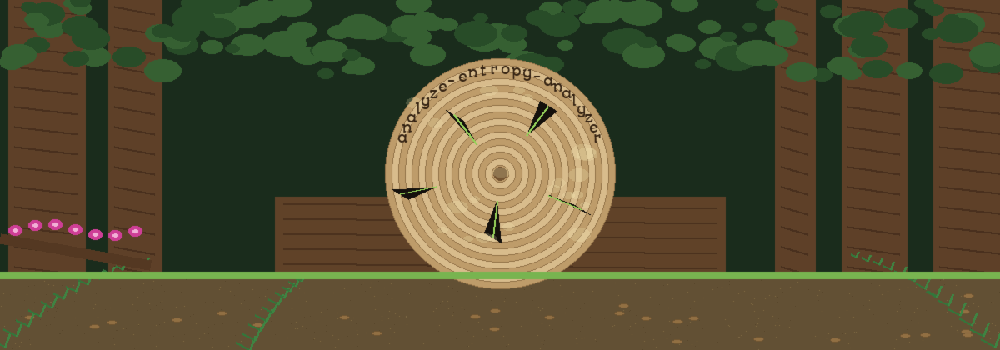
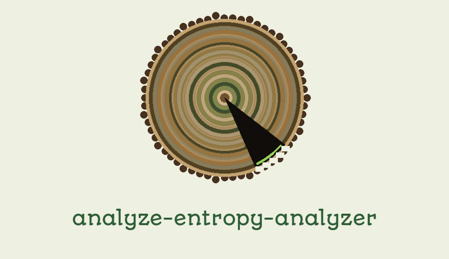

# analyze-entropy-analyzer

Calculate the Shannon entropy of files to identify potential obfuscation or encryption, focusing on automated data analysis and reporting

## Install
`git clone https://github.com/ShadowStrikeHQ/analyze-entropy-analyzer`

## Usage
`./analyze-entropy-analyzer [params]`

## Parameters
- `-h`: Show help message and exit
- `-o`: Optional: Specify an output file to store the entropy value.
- `-v`: No description provided

## License
Copyright (c) ShadowStrikeHQ

> Scar pocket note: -v arrives with no description in the source, and the usage line names no input file argument even though the tool is described as calculating the entropy of files. Both gaps are left as gaps here, with nothing invented to fill them.
